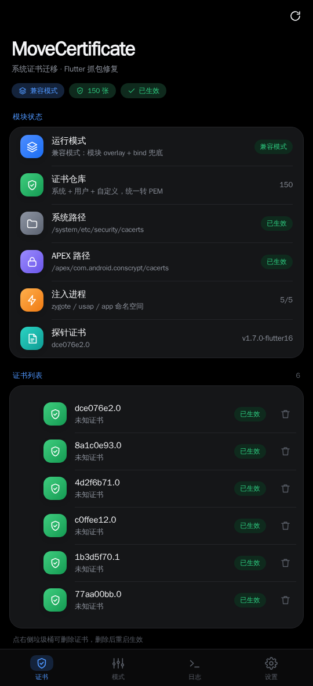
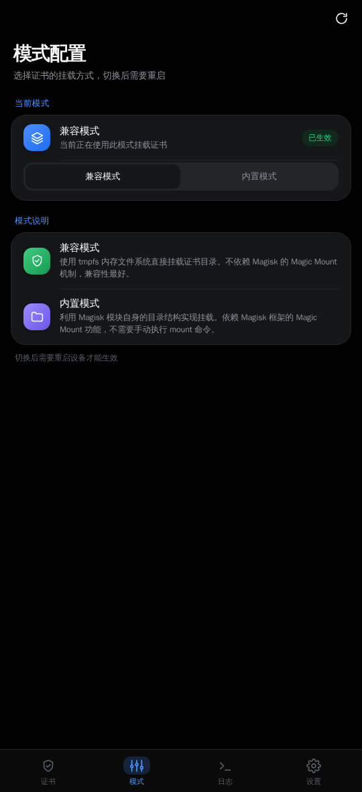
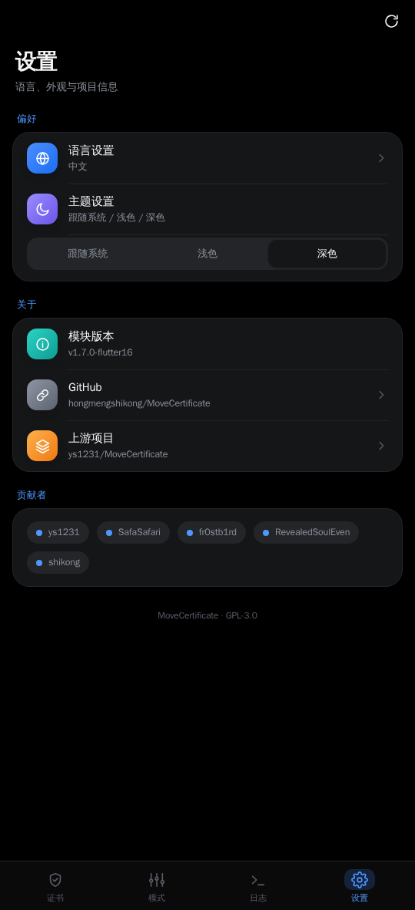
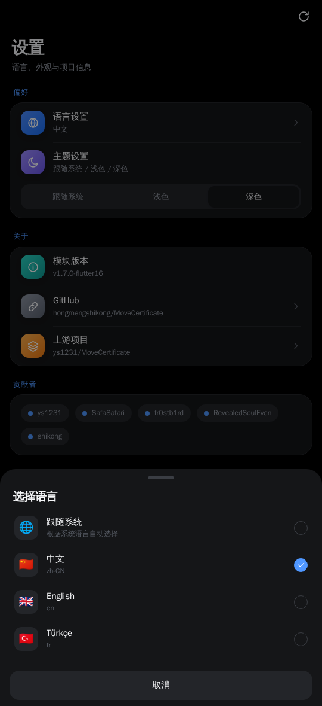

# [MoveCertificate](https://github.com/ys1231/MoveCertificate)

[English](README.en.md) | [Türkçe](README.tr.md)

这是一个 `Magisk/KernelSU/APatch` 模块，用于把用户证书移动到系统证书库，支持 `Android 7-16`（含 Android 16 / Flutter）。

> **本分支（v1.7.0-flutter16）重点修复：Android 16 上 Flutter/Dart 应用抓不到包。**
> 修复内容见下面「Flutter / Android 16 抓包」章节与 [FORK-FIX.md](FORK-FIX.md)。

# 原理（为什么以前 Android 14+ 的模块对 Flutter 无效）

| 使用方 | 读取哪个目录 | 需要的文件格式 |
|---|---|---|
| Java / OkHttp / Conscrypt | Android 14+ 读 `/apex/com.android.conscrypt/cacerts`，再回退 `/system/etc/security/cacerts` | PEM 或 DER 都行 |
| **Flutter / Dart（libflutter.so 里的 BoringSSL）** | 老引擎只读 `/system/etc/security/cacerts`；新引擎优先读 `/apex/com.android.conscrypt/cacerts` | **只能是 PEM，且文件名必须是 `<subject_hash_old>.0`** |

Dart 的 `security_context_linux.cc` 里是这样加载根证书的：

```cpp
const char* android_apex_cacerts   = "/apex/com.android.conscrypt/cacerts";
const char* android_system_cacerts = "/system/etc/security/cacerts";
if (Directory::Exists(nullptr, android_apex_cacerts) == Directory::EXISTS) {
  LoadRootCertCache(android_apex_cacerts);   // SSL_CTX_load_verify_locations(ctx, NULL, dir)
} else {
  LoadRootCertCache(android_system_cacerts);
}
```

而 BoringSSL 的 hash 目录是这么注册的（`crypto/x509/x509_d2.cc`）：

```cpp
X509_LOOKUP_add_dir(lookup, path, X509_FILETYPE_PEM);   // 只按 PEM 解析
```

所以：

* **DER 证书会被 Flutter 静默忽略**（Java 能读，Flutter 读不到）。
* 文件名不是 `<hash>.0` 的证书 Flutter 也找不到。
* 目录不在 app 的 mount namespace 里，Flutter 同样读不到（`/apex` 是 MS_PRIVATE 挂载）。

而 Android 在设置里安装的用户证书，`/data/misc/user/0/cacerts-added/<hash>.0` 写的是 **DER**（AOSP `TrustedCertificateStore.writeCertificate()` 里 `os.write(cert.getEncoded())`）。旧版模块直接把这些 DER 文件复制到系统证书目录，于是：
**Java 应用能抓包，Flutter 应用抓不到** —— 这正是本分支要修的问题。

本模块现在会：

1. 把「系统证书 + 用户证书 + 自定义证书」合并成一份仓库；
2. **全部统一转成 PEM**（文件名保持 `<hash>.0`）；
3. 通过模块 overlay 发布到 `/system/etc/security/cacerts`（Flutter 老路径，对所有 app 进程可见）；
4. 通过 tmpfs + bind 发布到 `/apex/com.android.conscrypt/cacerts`（Java 路径）；
5. `service.sh` 常驻，用 `nsenter` 把 APEX 目录注入到 zygote / usap / 已运行的 app 进程的 mount namespace —— 解决 Android 14/15/16 上 `/apex` 私有传播导致「证书只在 root shell 里能看到，app 里看不到」的问题。

# 版本支持

本分支不是只给 Android 16 的，**Android 7 - 16 全版本支持**，代码按 `ro.build.version.sdk` 分支：

| 版本 | 系统证书来源 | 发布的路径 | 额外动作 |
|---|---|---|---|
| Android 7-13（sdk <= 33） | `/system/etc/security/cacerts` | 模块 overlay → `/system/etc/security/cacerts`（overlay 不生效时 bind 兜底） | 无（没有 APEX） |
| **Android 14/15/16（sdk >= 34）** | `/apex/com.android.conscrypt/cacerts` | 同上 **+** APEX 两条路径 | tmpfs + bind，并对 zygote/usap/app 进程做 nsenter 注入 |

Flutter/Dart 的证书格式修复（DER → PEM、hash 文件名）是**全版本生效**的，
因为 Dart 的 BoringSSL 在 A7-A16 上读证书的方式完全一样。

版本矩阵自测（`tools/version-matrix.sh`，同一套脚本跑 sdk=33/34/35/36）：

```
sdk=33  seed_source=/system  apex_install=0  legacy_overlay=26  user_cert=PEM
sdk=34  seed_source=/apex    apex_install=1  legacy_overlay=26  user_cert=PEM
sdk=35  seed_source=/apex    apex_install=1  legacy_overlay=26  user_cert=PEM
sdk=36  seed_source=/apex    apex_install=1  legacy_overlay=26  user_cert=PEM
```

> `builtin`（纯 overlay、不挂载）模式在 A7-A13 完全可用；
> 在 A14+ 上 `$MODDIR/apex` 不一定被 magisk/kernelsu 挂载，
> 所以 A14+ 建议用默认的 `compatible` 模式。

# 使用方法

## 方式一：系统设置安装（推荐）

1. 手机设置 → 安全 → 加密与凭据 → 安装证书 → CA 证书，选择抓包工具的证书（.crt/.pem/.cer 均可）。
2. 安装完成后**重启**手机（或在 KernelSU/APatch 里点模块的 **Action** 按钮）。
3. WebUI / `install.log` 里应该能看到这张证书。

系统会把证书写到 `/data/misc/user/0/cacerts-added/<hash>.0`（DER），模块会自动转成 PEM 再发布，**不需要你手动转换格式**。

## 方式二：手动 push 到 `/data/local/tmp/cert`（多设备 / 内置证书用）

`/data/local/tmp/cert` 是模块的「自定义证书目录」，**每次开机**（或点 Action）都会重新导入一次。

```shell
# 1) 算出 Android 使用的文件名（必须！Flutter 按 hash 找文件）
openssl x509 -in cacert.pem -noout -subject_hash_old
# 假设输出 c8750f0d

# 2) 直接改名（PEM 格式最稳妥，DER 也可以，模块会自动转成 PEM）
cp cacert.pem c8750f0d.0

# 3) push 进手机
adb push c8750f0d.0 /data/local/tmp/cert/

# 4) 重启手机，或点模块的 Action 按钮
```

> **为什么你把证书放到 `/data/local/tmp/cert` 没生效？** 常见原因有 4 个：
>
> 1. **没有重启 / 没有点 Action**：模块只在开机（post-fs-data）和点 Action 时导入这个目录，放进去不会自动生效。
> 2. **文件名不对**：必须是 `<subject_hash_old>.0`，例如 `c8750f0d.0`。叫 `mitmproxy.pem`、`burp.cer` 这种名字，Java 应用可能还能用，**Flutter 一定找不到**。
> 3. **格式不对**：老版本模块会删掉非 DER 文件、README 也让人转成 DER——但 **Flutter 只认 PEM**。本版本两种都收，并且会自动把 DER 转成 PEM。
> 4. **证书不是 CA 证书**：必须是带 `basicConstraints=CA:TRUE` 的根证书，服务器证书/自签证书不行。

## 方式三：WebUI 查看 / 删除

模块自带一套 WebUI（KernelSU / APatch 的模块页面里打开），v1.7.1 起重做了界面：
大标题 + 分组卡片 + 彩色图标 + 底部导航 + 底部语言弹层，深色/浅色/跟随系统三态。

  

功能：

* **证书**：实时显示合并仓库里的证书，绿色「已生效」/ 橙色「未生效」，右侧垃圾桶删除（重启生效）
* **模块状态**：运行模式、证书数量、`/system` 与 APEX 两条路径的探针结果、注入进程数
* **模式**：兼容 / 内置分段切换（确认后写入 `mode.conf`，重启生效）
* **日志**：直接查看 `install.log`
* **设置**：语言（中文 / English / Türkçe / 跟随系统，底部弹层）、外观、版本与贡献者

<div align="center"></div>

## KernelSU / APatch 用户注意

如果 app 的 **App Profile** 里开启了「卸载模块 / Umount modules」，该 app 会看不到模块挂载的证书，抓包必然失败。
请把抓包目标 app 的这个选项关掉（或全局关闭），然后再点一次 Action / 重启。

# Flutter / Android 16 抓包

本版本（v1.7.x）针对 Android 16 的修复点：

1. **证书格式**：合并仓库统一 PEM（Android 用户证书是 DER，Flutter 读不了）。
2. **老路径**：`/system/etc/security/cacerts` 改由模块 overlay 提供（magic mount / overlayfs），不再依赖 post-fs-data 里的 bind 是否传播到 app 命名空间；overlay 没生效时还会自动 bind 兜底。
3. **新路径**：`service.sh` 常驻注入 `/apex/com.android.conscrypt/cacerts` 到 zygote / usap / 已运行 app 的 namespace，并在 zygote 重启后自动重新注入。
4. **诊断**：新增 `action.sh`，在 KernelSU/APatch 里点 Action 会输出证书数量、两条路径是否带上了你的证书、注入状态；日志在 `/data/adb/modules/MoveCertificate/install.log`，状态快照在 `status.txt`。

验证过的事实（用真实的 Dart VM + BoringSSL 跑过）：

| 证书目录内容 | Flutter/Dart 结果 |
|---|---|
| `<hash>.0` + **DER**（Android 用户证书原样） | ❌ `CERTIFICATE_VERIFY_FAILED: unable to get local issuer certificate` |
| `<hash>.0` + **PEM**（本模块转换后） | ✅ 200 |
| PEM 但文件名不是 hash | ❌ 找不到 |

如果某个 Flutter app 装了证书还是抓不到，先排除 app 自己做了 **SSL Pinning**（需要在 frida 层 hook `libflutter.so` 的 `ssl_verify_cert_chain` / `SSL_CTX_set_custom_verify`），这已不是证书问题。

# 排查方法

1. 点模块 **Action**（KernelSU / APatch），看输出里的：
   * `cert store`：仓库证书数量（正常 100+）
   * `probe cert`：你装的那张证书（探针）
   * `/system/etc/security/cacerts` 与 `/apex/.../cacerts` 是否 `探针: yes`
2. 看 `/data/adb/modules/MoveCertificate/install.log`（每次开机重写）。
3. root shell 里手动确认：
   ```shell
   ls -l /system/etc/security/cacerts/c8750f0d.0
   ls -l /apex/com.android.conscrypt/cacerts/c8750f0d.0
   head -c 11 /system/etc/security/cacerts/c8750f0d.0   # 应输出 -----BEGIN 
   nsenter --mount=/proc/<app pid>/ns/mnt -- ls /apex/com.android.conscrypt/cacerts
   ```

# 构建

```shell
./buildzip.sh all   # 需要 node/npm 编译 WebUI
./buildzip.sh sweb  # 跳过 WebUI 编译
```

# 使用实测


## Star History

[](https://star-history.dera.page/#ys1231/MoveCertificate&Date)

# 参考链接:
- http://www.zhuoyue360.com/crack/60.html
- https://topjohnwu.github.io/Magisk/guides.html#boot-scripts
- https://github.com/Magisk-Modules-Repo/movecert
- https://github.com/andyacer/movecert
- https://book.hacktricks.xyz/v/cn/mobile-pentesting/android-app-pentesting/install-burp-certificate#android-14-zhi-hou 
- https://kernelsu.org/zh_CN/guide/module.html
- https://github.com/dart-lang/sdk/blob/main/runtime/bin/security_context_linux.cc
- https://github.com/google/boringssl/blob/master/crypto/x509/x509_d2.cc